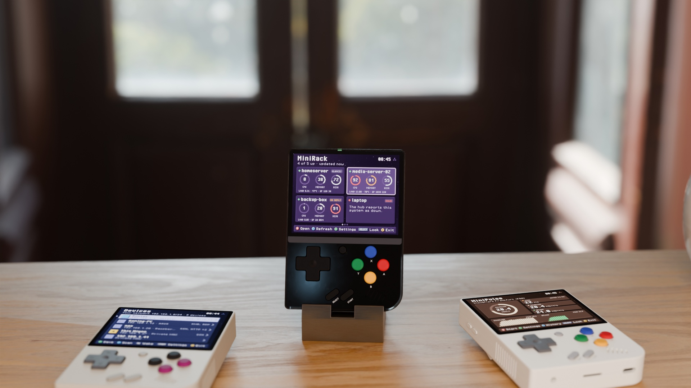
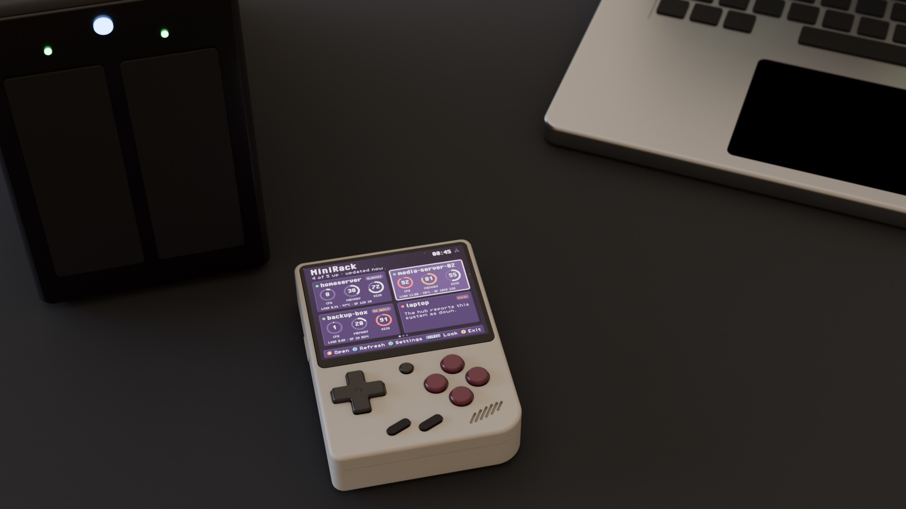

<p align="center"></p>

[](https://github.com/zakijss/MiniRack/actions/workflows/ci.yml)
[](https://github.com/zakijss/MiniRack/releases)
[](LICENSE)

# MiniRack

Live CPU, memory, disk, temperature, load and uptime for your servers, on a Miyoo Mini Plus. Part of [MiniDeck](https://github.com/zakijss/MiniDeck).

- Sources: [Glances](https://github.com/nicolargo/glances) (one machine), a [Beszel](https://beszel.dev) hub (every machine it watches) and [Vantage](https://github.com/zakijss/Vantage).
- A card per machine, a detail page with every disk, sensor and service, and why a machine is down. A hot or overloaded machine shows its temperature and load in orange (from 75 °C, or a load of 1 per thread) or red (from 90 °C, or 2 per thread).
- Settings for the refresh interval, °C or °F, the order of the machines (name, CPU, memory, load or status) and hiding machines that are down.
- Servers on your tailnet through [MiniScale](https://github.com/zakijss/MiniScale), or on your home network directly.
- Passwords are kept on the card only encrypted, with the device key.


<p align="center"></p>

## Using it

The first start asks for a source: type the address on the on-screen keyboard or pick a device from your tailnet; **Save** tests the connection first. **Y** opens the sources and settings later. On the overview, **A** opens a machine and **X** refreshes; on a machine's page, **L1**/**R1** step to the other machines, **Up**/**Down** scroll and **X** refreshes too. The selected machine stays selected after Settings. On the overview, **SELECT** changes the look. Use a read-only Beszel user.

## Install

- **MiniMart:** open [MiniMart](https://github.com/zakijss/MiniMart), then **Apps > MiniRack**. It checks the download and keeps your settings on updates.
- **Zip:** download `minirack-VERSION.zip` from [Releases](https://github.com/zakijss/MiniRack/releases/latest), unzip it onto the root of the SD card, and restart.
- **Every MiniDeck app at once:** [minideck-all.zip](https://github.com/zakijss/MiniDeck/releases/latest/download/minideck-all.zip).

## Requirements

A Miyoo Mini Plus on Onion OS 4.4, with Wi-Fi. A server running Glances (`glances -w`), Beszel or Vantage. Other devices and firmwares aren't supported.

## Building

```sh
make check                     # vet, tests, scripts
make package VERSION=1.0.0     # dist/: the release zip, app.json, SHA256SUMS
make deploy HOST=root@miyoo    # build and copy to a device over SSH
```

Go runs in Docker unless you pass `GO=go` (Go 1.27). The interface, themes and networking come from the [MiniDeck library](https://github.com/zakijss/MiniDeck); see its [development notes](https://github.com/zakijss/MiniDeck/blob/main/docs/DEVELOPMENT.md) and [contributing guide](https://github.com/zakijss/MiniDeck/blob/main/CONTRIBUTING.md).

## License

[MIT](LICENSE). Third-party components are listed in [NOTICE](NOTICE). Not made by or affiliated with Miyoo.
